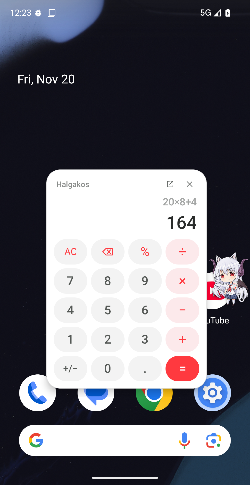

# Halgakos Calculator

A simple, offline calculator for Android with circular keys, coral accents, and answers that update as you type. Halgakos, its mascot, can float over your other apps with a mini calculator in hand.

Formerly Coral Calculator.

[Download the latest release](https://github.com/Shirochi-stack/coral-calculator/releases/latest) · Android 8.0 or later


## Features

- **Everyday calculations:** addition, subtraction, multiplication, division, percentages, and decimal numbers.
- **Live answers:** see the result while entering a calculation, with multiplication and division handled before addition and subtraction.
- **Clear results:** after equals, the calculation stays visible above the larger answer, with a smooth transition between editing and results.
- **Easy corrections:** press backspace after equals to return to the calculation and edit it.
- **Large, easy-to-read text:** oversized digits on the display, keys, and dialogs, with a blinking cursor marking the number you are entering. Long calculations keep their full size: swipe the display sideways to see the rest.
- **Readable numbers:** thousands separators make large values easier to read, such as `1,000`, `10,000`, and `100,000`.
- **Memory and history:** store a value in memory or reuse any of your last 100 completed calculations.
- **Unit conversion:** convert length, mass, and temperature without an internet connection.
- **Currency conversion:** calculate amounts using an exchange rate you enter yourself.
- **Halgakos companion:** a mini Halgakos who floats over other apps. Tap her for a compact calculator, hold her for her menu, and drag her anywhere. An animated, pink-haired Halgakos is there if you want her to move.
- **Your preferred view:** switch to dark appearance or fullscreen, rotate to landscape, and turn key vibration on or off.
- **Convenient input:** labeled buttons, hardware keyboard support, and long-press result copying.

## Install

1. Open the [latest release](https://github.com/Shirochi-stack/coral-calculator/releases/latest) and download the `.apk` file under **Assets**.
2. Open the downloaded file on your Android device.
3. If Android asks, allow your browser or file manager to install apps from this source, then tap **Install**.

The current APK is a debug-signed preview build. The APK is the only download needed to install the app; `SHA256SUMS.txt` is available for optional download verification.

## Using the calculator

- Enter a calculation to see a live answer. Tap **=** to finish and add it to history. Your calculation stays visible in gray above the larger answer. Tap **=** again to repeat the last operation.
- To continue a calculation, tap **+**, **−**, **×**, or **÷** after **=**. The original equation returns for editing with that operator appended, so the numbers you entered stay visible. Normal order of operations applies: `2+3`, then **=**, then `×4`, then **=**, gives `14` from `2+3×4`.
- Tap **+/−** after **=** to restore the equation and change the sign of its last number. For example, `5+3` becomes `5+−3`, with a live answer of `2`.
- After **=**, tap **⌫** once to restore the calculation that produced the answer. Tap it again to delete the last character, or continue editing the restored expression.
- After **=**, tap the gray calculation or the answer to place the cursor there. Nothing changes until you press a key: a key in the calculation brings it back for editing at that spot, and a key in the answer edits the answer itself as a new number. Long-pressing to copy removes the cursor again.
- Tap anywhere in the calculation to move the cursor there. Digits, operators, **⌫**, **%**, and **+/−** then apply at the cursor instead of the end. Deleting a number's only digit leaves a `0` that the next digit replaces. Long calculations fade at the edge; swipe them sideways to reach the earlier part.
- On unfolded foldables and tablets the keys widen to fill the screen. Held sideways, the display and the keypad sit either side of the centre, and a long calculation continues on further lines instead of running off the edge. Swipe it up and down when it has more lines than fit. Phones keep a single line that swipes sideways.
- If you leave an operator at the end, the subtotal stays visible and **=** totals the numbers already entered.
- Use **AC** to clear the calculation, **⌫** to delete the last character, and **+/−** to change the current number's sign. **AC** keeps your memory and history.
- For percentages, `200 + 10%` gives `220`, while `200 × 10%` gives `20`.
- Tap the **history icon** above the memory row to view completed calculations. Tap an entry to use its result.
- Long-press the expression or result to copy the current answer.

### Memory

| Key | Action |
| --- | --- |
| **mc** | Clear the stored value. |
| **m+** | Add the current value to memory. |
| **m−** | Subtract the current value from memory. |
| **mr** | Replace the current number with the stored value. |

The **mr** key turns coral when memory contains a nonzero value. Your current calculation and memory are saved when you close the app.

### Converters and settings

The **unit converter** and **currency converter** sit beside history. Choose the units or currencies, enter an amount, and tap **Use result** to bring the converted value into the calculator. Currency conversion requires a positive exchange rate; the app does not fetch live rates.

Use the **top-right settings icon** to change appearance or key vibration. The icon beside it toggles fullscreen, and Halgakos, next to that, opens the companion's settings.

### Halgakos companion



The companion is switched on from the start. The first time you open the calculator it offers Android's permission to display over other apps: choose Halgakos Calculator in the list Android shows, allow it, and come back. She appears once you leave the calculator. If you chose **Not now**, switch on **Show Halgakos** in **Settings › Halgakos companion** to be asked again.

- **Tap** her to open the mini calculator over the app you are in. Tap her again, or use the **✕** in its corner, to close it.
- **Hold** her for her menu: the mini calculator, the full calculator, her settings, and **Hide Halgakos**.
- **Drag** her anywhere on the screen. She stays where you drop her.
- The mini calculator works on the same calculation as the app. The arrow in its corner opens the app with the same numbers, and long-pressing its display copies the result.
- To hide her, **drag her onto the ✕** that appears at the bottom of the screen, or use her menu. The switch in her settings brings her back.

Her settings open from her menu, or from Halgakos herself beside the full screen button at the top of the calculator:

| Setting | What it does |
| --- | --- |
| **Animated Halgakos** | Her pink-haired form breathes and blinks, runs the way you drag her, and works alongside the mini calculator. Off by default: the still Halgakos uses less battery. |
| **Tap for the mini calculator** | Turn off to swap the two: a tap opens her menu and a hold the mini calculator. |
| **Only while unfolded** | On a foldable, she stays away while the device is folded shut and returns when you open it. |
| **Hide while the calculator is open** | She steps aside while you are in the app. On by default. |
| **Snap to the edge** | She slides to the nearer side of the screen when you let go. Off by default. |
| **Fade when resting** | She turns translucent once she has been left alone. The slider under it sets how soon, from half a second to ten seconds; it starts at a second and a half. |
| **Size** | Small, medium, or large. |

She keeps her place when the device is folded, unfolded, or turned, and comes back after a restart. Android hides her on the lock screen and over its own Settings and permission screens.

While she is on screen, Android posts a notification of its own saying that Halgakos Calculator is displaying over other apps. It belongs to Android, so its icon and wording cannot be changed by the app, but **Turn off that notification** at the bottom of her settings opens the place to switch it off.

## Privacy

Halgakos Calculator works entirely offline. It has no ads, analytics, accounts, or network permission. Calculation history and settings are stored on your device. Clear saved calculations from the **History** dialog.

The companion needs Android's permission to display over other apps, which is used only to draw her and her mini calculator. See the [privacy policy](PRIVACY.md).

<details>
<summary>Build from source</summary>

Use JDK 17 and Android SDK platform 36 with build-tools 35.0.0. Set `ANDROID_HOME` to the SDK directory, or configure `sdk.dir` in a local `local.properties` file.

On Windows:

```powershell
.\gradlew.bat testDebugUnitTest lintDebug assembleDebug
```

On macOS or Linux:

```sh
./gradlew testDebugUnitTest lintDebug assembleDebug
```

The APK is generated at `app/build/outputs/apk/debug/app-debug.apk`. The project includes the Gradle wrapper, and GitHub Actions builds and checks each push and pull request.

Arithmetic uses 16 significant decimal digits and supports decimal exponents from −100 to 100. See [verification results](docs/verification-1.0.5.md) for build and emulator checks.

The launcher icon and the companion's figure are generated from `assets/HalgakosWhite.png` by `python tools/make_art.py`, which needs Pillow. The animated companion's frames come from the Halgakos Codex pet atlas, which is kept in its own repository; `python tools/make_art.py --pet path/to/spritesheet-v2-smooth.webp` rebuilds them.

For a signed Google Play bundle, put the upload key's `storeFile`, `storePassword`, `keyAlias` and `keyPassword` in a `keystore.properties` file beside `settings.gradle` and run `gradlew bundleRelease`. Without that file the bundle is built unsigned.

</details>

## License

The code of Halgakos Calculator is available under the [MIT License](LICENSE).

Halgakos, the Glossarion mascot, is © 2026 Shirochi-stack, all rights reserved. Her artwork in this repository and in the app (`assets/`, the launcher icon, the companion's figure and animation frames, and `store/`) is not covered by the MIT License and may not be reused without permission.
