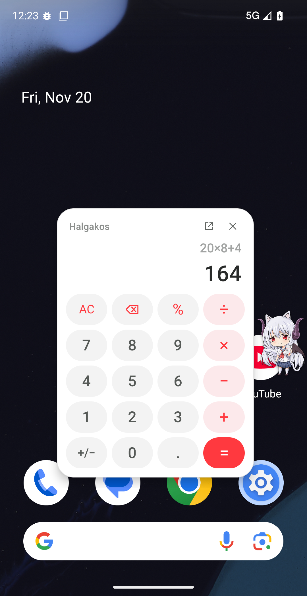

## Coral Calculator is now Halgakos Calculator

The app has a new name and a new icon: Halgakos, holding her calculator. It installs over Coral Calculator, and your history, memory and settings carry over.

## Halgakos companion

A mini Halgakos can now float over your other apps, so a calculator is always one touch away.

- **Turn her on** in **Settings › Halgakos companion**. Android asks once for permission to display over other apps.
- **Drag** her anywhere. She slides to the nearer edge of the screen when you let go.
- **Hold** her to open a compact calculator on top of whatever you are doing. Hold or tap her again to close it.
- **Tap** her for a menu: the mini calculator, the full calculator, or her settings.
- The mini calculator and the app share one calculation. The arrow in its corner opens the app with the same numbers, and whatever you finish there is in History.
- **Drag her onto the ✕** that appears at the bottom of the screen to hide her. The switch in her settings brings her back.

### Her settings

- **Only while unfolded:** on a foldable, she stays away while the device is folded shut and returns when you open it.
- **Hide while the calculator is open**, on by default.
- **Snap to the edge**, or leave her wherever you drop her.
- **Fade when resting**, so she covers less of what is underneath.
- **Size:** small, medium or large.

She keeps her place when you fold, unfold or turn the device. On an unfolded screen the mini calculator opens on her side of the fold, and it shrinks to fit when a screen is short.

## Also in this release

- Built for Android 16.
- The app now asks for two permissions, both for the companion: displaying over other apps, and starting after the device restarts so that she comes back on her own. It still has no network access. See the [privacy policy](https://github.com/Shirochi-stack/coral-calculator/blob/master/PRIVACY.md).

## Update

Download **Halgakos-Calculator-1.1.0.apk** below and open it on your Android device. Install over your current version to keep history and memory; no uninstall is needed.

Requires Android 8.0 or later. This is a debug-signed preview build.

Only the APK is needed to install. `SHA256SUMS.txt` is available for optional download verification. Halgakos Calculator is licensed under [MIT](https://github.com/Shirochi-stack/coral-calculator/blob/master/LICENSE), with a copy included below.
